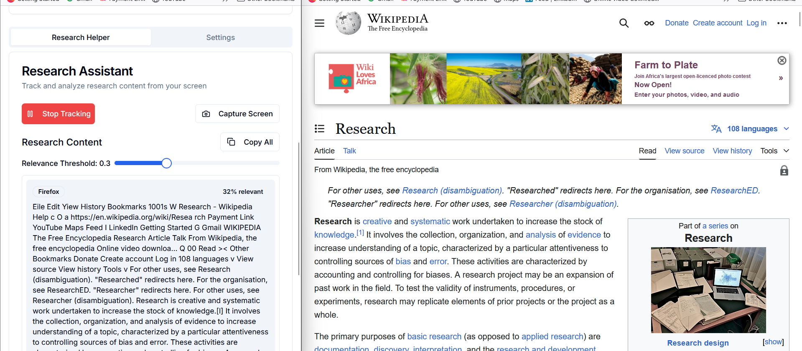

# Research Assistant

An AI-powered research assistant that captures, analyzes, and organizes research content from your screen with automation capabilities.



## Overview

Research Helper is a Next.js application that uses Screenpipe to capture your screen content while you're conducting research. It intelligently analyzes the captured text, identifies research-relevant content, and provides an AI assistant to help you understand and work with your research materials.

## Features

### Core Functionality
- **Intelligent Content Capture**: Automatically captures and analyzes screen content for research relevance
- **Relevance Scoring**: Uses advanced algorithms to score and prioritize research content
- **Content Organization**: Automatically organizes captured research by relevance and source
- **AI-Powered Research Assistant**: Ask questions about your research and get intelligent responses

### Automation
- **Web Research Automation**: Automate searching for research content on the web
- **Pixel-Level Control**: Programmatically control your mouse and keyboard for research tasks
- **Custom Workflows**: Create automated research workflows with the pixel automation tools

### User Experience
- **Real-time Feedback**: Immediate visual feedback when capturing screen content
- **Adjustable Relevance Threshold**: Fine-tune what content is considered research-relevant
- **Copy & Export**: Easily copy individual research items or export all content
- **Context Selection**: Select specific research content to focus your AI queries

## Prerequisites

- Node.js 18 or later
- Screenpipe service running locally (typically on port 3030)
- Nebius AI API key for AI research assistance

## Setup

1. Clone the repository:
   ```bash
   git clone https://github.com/fadexadex/research-assistant-pipe.git
   cd research-assistant-pipe

